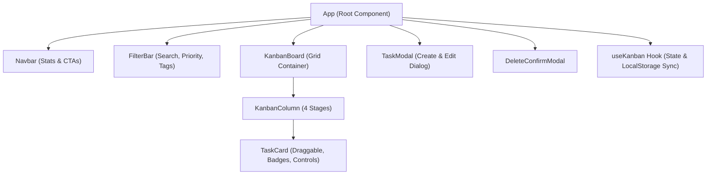

# ⚡ KanbanFlow — Interactive Project Task Board

[](https://react.dev/)
[](https://vitejs.dev/)
[](https://tailwindcss.com/)
[](https://opensource.org/licenses/MIT)

> A modern, responsive single-page Kanban board web application built with **React**, **Tailwind CSS**, and **Vite**. Demonstrates core frontend engineering skills including immutable state updates, custom hooks, HTML5 drag-and-drop, full-text filtering, and persistent browser storage.

---

## 🎯 Overview

**KanbanFlow** is designed to replicate production-grade task tracking interfaces (like Jira and Trello) inside a clean, lightweight Single-Page Application (SPA). It requires zero complex routing configurations and focuses on component composition, state lifting, and interactive micro-interactions.

---

## ✨ Key Features

- 🔄 **Two Ways to Move Tasks**:
  - **HTML5 Drag-and-Drop**: Drag cards freely between any stage column (*To Do*, *In Progress*, *In Review*, *Completed*).
  - **1-Click Quick Move Controls**: Dedicated directional navigation buttons (← and →) ensuring accessibility on touchscreens and keyboards.
- 💾 **Persistent Local Storage**:
  - All tasks, stage changes, and edits automatically synchronize with browser `localStorage`.
  - Includes a **"Reset Demo Data"** action to quickly restore realistic sample sprint tasks.
- 🔍 **Real-Time Search & Multi-Level Filtering**:
  - Instant full-text search across task titles, descriptions, and tags.
  - Priority filter pills (*Urgent*, *High*, *Medium*, *Low*).
  - Tag/category dropdown selector (*#Frontend*, *#Backend*, *#Design*, *#Bug*, etc.).
- 📊 **Dynamic Dashboard Metrics**:
  - Live progress meter and completion percentage ring that recalculates as tasks move to "Completed".
  - Active task counters per column and filter match summaries.
- 📝 **Full CRUD Functionality**:
  - **Create**: Add tasks with title, description, column stage, priority, due date, and custom tags.
  - **Read**: Rich card previews with overdue date indicators and priority badges.
  - **Update**: Edit any existing task via an accessible modal dialog.
  - **Delete**: Safe deletion modal with confirmation.
- 📱 **Responsive Modern Design**:
  - Crafted with Tailwind CSS, supporting mobile stacked views, tablet splits, and desktop 4-column kanban layouts.

---

## 🏗️ Architecture & Component Flow



### Component Breakdown
- **`useKanban`**: Custom hook encapsulating state manipulation, LocalStorage syncing, and derived statistical calculations.
- **`Navbar`**: Displays project branding, completion percentage progress bar, and primary actions.
- **`FilterBar`**: Search input with debounced UX, priority filter pills, and active filter clear badge.
- **`KanbanBoard` & `KanbanColumn`**: Droppable grid containers managing drag events and empty column states.
- **`TaskCard`**: Draggable presentation card with priority chips, due date warnings, tags, and quick-move controls.
- **`TaskModal`**: Controlled form handling validation, custom tag generation, and editing.

---

## 🛠️ Tech Stack & Skills Demonstrated

| Technology / Pattern | Purpose |
| :--- | :--- |
| **React 18** | Functional components, Hooks (`useState`, `useEffect`, `useMemo`), Controlled inputs |
| **Custom Hooks** | Encapsulating reusable business logic and persistence (`useKanban`) |
| **Tailwind CSS** | Utility-first responsive styling, micro-animations, color gradients |
| **Lucide React** | Clean, accessible iconography |
| **HTML5 Drag & Drop API** | Native, dependency-free interactive card dragging |
| **Vite** | Fast HMR (Hot Module Replacement) and optimized production bundling |

---

## 🚀 Quick Start Guide

### Prerequisites
Make sure you have **Node.js** (v18 or higher) and **npm** installed on your system.

### Installation

1. **Clone the repository:**
   ```bash
   git clone https://github.com/<your-username>/react-kanban-board.git
   cd react-kanban-board
   ```

2. **Install dependencies:**
   ```bash
   npm install
   ```

3. **Start the local development server:**
   ```bash
   npm run dev
   ```
   Open `http://localhost:5173` in your browser.

4. **Build for production:**
   ```bash
   npm run build
   ```
   The production-ready assets will be compiled to the `dist/` directory.

---

## 📂 Project Structure

```text
react-kanban-board/
├── index.html
├── package.json
├── postcss.config.js
├── tailwind.config.js
├── vite.config.js
├── src/
│   ├── App.jsx                     # Root application coordinator
│   ├── index.css                   # Tailwind directives & custom scrollbars
│   ├── main.jsx                    # Application entry point
│   ├── types/
│   │   └── kanban.js               # Columns, priorities, initial mock data
│   ├── hooks/
│   │   └── useKanban.js            # Central state store & LocalStorage hook
│   └── components/
│       ├── Navbar.jsx              # Header, metrics, reset button
│       ├── FilterBar.jsx           # Search input, priority pills, tag select
│       ├── KanbanBoard.jsx         # 4-column responsive grid container
│       ├── KanbanColumn.jsx        # Droppable column & quick-add
│       ├── TaskCard.jsx            # Draggable card with quick-move & edit
│       ├── TaskModal.jsx           # Form dialog for create & edit
│       └── DeleteConfirmModal.jsx  # Confirmation dialog for card deletion
└── README.md
```

---

## 📄 License

This project is open-source and available under the [MIT License](LICENSE).
